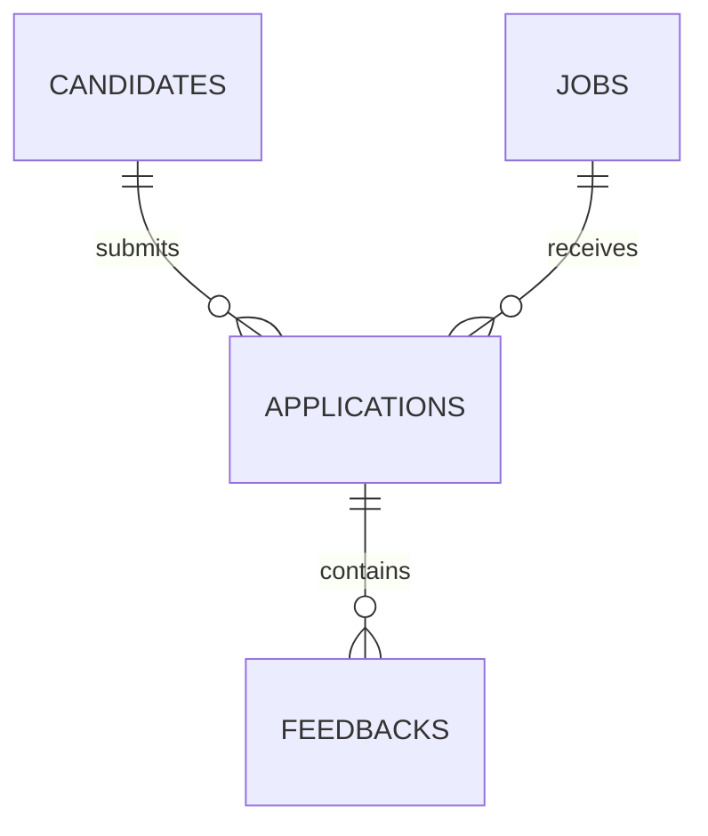

# CandidFlow API

API REST para gerenciar vagas, candidatos, candidaturas e feedbacks. O projeto foi construído em Java 21 com Spring Boot, persistência Oracle, migrações Flyway e execução em Docker.

## Tecnologias

- Java 21
- Spring Boot 4.1.1
- Spring Web MVC
- Spring Data JPA e Hibernate
- Oracle Autonomous AI Database
- Flyway
- Bean Validation
- Lombok
- Docker
- Maven

## Modelo de dados



Uma candidatura pertence a exatamente um candidato e uma vaga. Um feedback pertence a exatamente uma candidatura. O banco impede candidaturas duplicadas para o mesmo par candidato/vaga.

## Estrutura em camadas

```text
src/main/java/br/com/candidflow
├── controller
├── dto
│   ├── request
│   └── response
├── entity
├── enums
├── exception
├── mapper
├── repository
└── service
```

Fluxo principal:

```text
Requisição HTTP → Controller → Service → Repository → Hibernate/JDBC → Oracle
Resposta JSON   ← Controller ← Service ← Mapper     ← Entidade
```

## Endpoints

### Candidatos

| Método | Endpoint | Operação |
|---|---|---|
| `POST` | `/api/candidates` | Cadastrar |
| `GET` | `/api/candidates` | Listar com paginação |
| `GET` | `/api/candidates/{id}` | Consultar por ID |
| `PUT` | `/api/candidates/{id}` | Atualizar |
| `DELETE` | `/api/candidates/{id}` | Excluir |

### Vagas

| Método | Endpoint | Operação |
|---|---|---|
| `POST` | `/api/jobs` | Cadastrar |
| `GET` | `/api/jobs` | Listar com paginação |
| `GET` | `/api/jobs/{id}` | Consultar por ID |
| `PUT` | `/api/jobs/{id}` | Atualizar |
| `DELETE` | `/api/jobs/{id}` | Excluir |

### Candidaturas

| Método | Endpoint | Operação |
|---|---|---|
| `POST` | `/api/applications` | Criar |
| `GET` | `/api/applications` | Listar com paginação |
| `GET` | `/api/applications/{id}` | Consultar por ID |
| `GET` | `/api/applications/candidate/{candidateId}` | Listar por candidato |
| `GET` | `/api/applications/job/{jobId}` | Listar por vaga |
| `PUT` | `/api/applications/{id}` | Atualizar |
| `PATCH` | `/api/applications/{id}/status` | Atualizar somente o status |
| `DELETE` | `/api/applications/{id}` | Excluir |

### Feedbacks

| Método | Endpoint | Operação |
|---|---|---|
| `POST` | `/api/feedbacks` | Criar |
| `GET` | `/api/feedbacks` | Listar com paginação |
| `GET` | `/api/feedbacks/{id}` | Consultar por ID |
| `GET` | `/api/feedbacks/application/{applicationId}` | Listar por candidatura |
| `PUT` | `/api/feedbacks/{id}` | Atualizar |
| `DELETE` | `/api/feedbacks/{id}` | Excluir |

Health check:

```http
GET /actuator/health
```

## Executar localmente

Defina as variáveis no PowerShell:

```powershell
$env:DB_URL='jdbc:oracle:thin:@(description=...connection string TLS candidflow_tp...)'
$env:DB_USERNAME='CANDIDFLOW_APP'
$env:DB_PASSWORD='senha_do_usuario_da_aplicacao'
```

Execute:

```powershell
.\mvnw.cmd spring-boot:run
```

Teste:

```powershell
Invoke-RestMethod http://localhost:8080/actuator/health
```

## Testes das requisições

Importe no Postman:

```text
postman/CandidFlow.postman_collection.json
```

A coleção está ordenada e salva automaticamente os IDs criados. Execute-a do item `01` ao `25`. Ao testar o deploy, altere a variável `baseUrl` da coleção para a URL pública do Render.

Para os testes automatizados:

```powershell
.\mvnw.cmd test
```

## Docker

Construa a imagem:

```powershell
docker build -t candidflow-api .
```

Execute usando as variáveis já presentes no PowerShell:

```powershell
docker run --name candidflow-api --rm -p 8080:8080 `
  -e DB_URL="$env:DB_URL" `
  -e DB_USERNAME="$env:DB_USERNAME" `
  -e DB_PASSWORD="$env:DB_PASSWORD" `
  candidflow-api
```

Ou utilize:

```powershell
docker compose up --build
```

## Deploy

As instruções completas estão em [`docs/DEPLOY_RENDER.md`](docs/DEPLOY_RENDER.md).

## Regras implementadas

- E-mail de candidato deve ser único.
- Uma vaga nova recebe status `OPEN` quando o status não é enviado.
- Não é possível candidatar-se a uma vaga fechada.
- Um candidato não pode se candidatar duas vezes à mesma vaga.
- Candidatos e vagas com candidaturas não podem ser excluídos.
- A exclusão de uma candidatura remove seus feedbacks por cascata no banco.
- Entradas inválidas retornam `400` com os campos problemáticos.
- Recursos inexistentes retornam `404`.
- Violações de regras de negócio retornam `409`.

## Arguição

Consulte [`docs/ARGUICAO.md`](docs/ARGUICAO.md) para a explicação da arquitetura, do fluxo de uma requisição, das anotações Lombok e das decisões técnicas.
